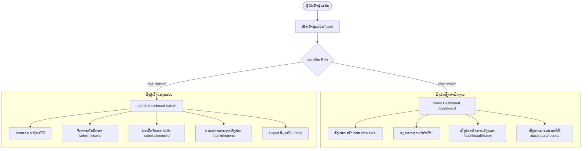

# ລະບົບຕິດຕາມ ແລະ ປະເມີນຜົນນັກສຶກສາຝຶກງານ (Lao Telecom Intern Tracking System)

> **ລະບົບຄຸ້ມຄອງ, ຕິດຕາມເວລາ ແລະ ປະເມີນຜົນການຝຶກງານອອນລາຍ**  
> ພັດທະນາຂຶ້ນສຳລັບ **ບໍລິສັດ ລາວ ໂທລະຄົມມະນາຄົມ ມະຫາຊົນ (Lao Telecom - LTC)**

---

## 📑 ສາລະບານ (Table of Contents)
1. [ພາບລວມຂອງລະບົບ (System Overview)](#1-ພາບລວມຂອງລະບົບ-system-overview)
2. [ເຕັກໂນໂລຢີທີ່ນຳໃຊ້ (Tech Stack)](#2-ເຕັກໂນໂລຢີທີ່ນຳໃຊ້-tech-stack)
3. [ໂຄງສ້າງລະບົບ ແລະ ບົດບາດຜູ້ໃຊ້ (User Roles & Architecture)](#3-ໂຄງສ້າງລະບົບ-ແລະ-ບົດບາດຜູ້ໃຊ້-user-roles--architecture)
4. [ຟັງຊັນຫຼັກຂອງລະບົບ (Core Features)](#4-ຟັງຊັນຫຼັກຂອງລະບົບ-core-features)
   - [4.1 ລະບົບນັກສຶກສາຝຶກງານ (Intern Portal)](#41-ລະບົບນັກສຶກສາຝຶກງານ-intern-portal)
   - [4.2 ລະບົບຜູ້ເບິ່ງແຍງ (Admin Portal)](#42-ລະບົບຜູ້ເບິ່ງແຍງ-admin-portal)
5. [ເງື່ອນໄຂ ແລະ Logic ການເຮັດວຽກສຳຄັນ (Business Logic)](#5-ເງື່ອນໄຂ-ແລະ-logic-ການເຮັດວຽກສຳຄັນ-business-logic)
   - [GPS Geofencing](#gps-geofencing)
   - [ການຕັດເວລາ ແລະ ສະຖານະ](#ການຕັດເວລາ-ແລະ-ສະຖານະ)
   - [ລະບົບການຄິດໄລ່ເກຣດປະເມີນຜົນ](#ລະບົບການຄິດໄລ່ເກຣດປະເມີນຜົນ)
6. [ໂຄງສ້າງຖານຂໍ້ມູນ (Firestore Collections Schema)](#6-ໂຄງສ້າງຖານຂໍ້ມູນ-firestore-collections-schema)
7. [ໂຄງສ້າງໂຟນເດີໂຄງການ (Directory Structure)](#7-ໂຄງສ້າງໂຟນເດີໂຄງການ-directory-structure)
8. [ວິທີການຕິດຕັ້ງ ແລະ ເປີດໃຊ້ງານ (Installation & Setup)](#8-ວິທີການຕິດຕັ້ງ-ແລະ-ເປີດໃຊ້ງານ-installation--setup)

---

## 1. ພາບລວມຂອງລະບົບ (System Overview)
ລະບົບ **Intern Tracking System** ຖືກອອກແບບມາເພື່ອຫັນປ່ຽນການຄຸ້ມຄອງນັກສຶກສາຝຶກງານຂອງ **ລາວ ໂທລະຄົມ** ໃຫ້ເປັນລະບົບດິຈິທັອກທີ່ທັນສະໄໝ:
- **ຕັດບັນຫາການລົງເວລາແທນກັນ:** ດ້ວຍລະບົບກວດສອບພິກັດດາວທຽມ (GPS Geofencing) ທີ່ບັງຄັບໃຫ້ລົງເວລາໄດ້ສະເພາະຕອນຢູ່ໃນບໍລິເວນສຳນັກງານເທົ່ານັ້ນ.
- **ລາຍງານວຽກປະຈຳວັນແບບ Realtime:** ນັກສຶກສາສາມາດບັນທຶກການເຮັດວຽກ ແລະ ຫົວໜ້າ/Admin ສາມາດກວດສອບໄດ້ທັນທີ.
- **ຕິດຕາມ ແລະ ປະເມີນຜົນອັດຕະໂນມັດ:** ຄິດໄລ່ຊົ່ວໂມງເຮັດວຽກ, ເປີເຊັນການມາຝຶກງານ, ການຕັດເກຣດຜົນງານ (A, B, C, D, F) ແລະ ການໃຫ້ຄະແນນທັກສະ (Skills Evaluation).
- **Export ຂໍ້ມູນໄດ້ງ່າຍ:** ຮອງຮັບການດາວໂຫຼດບົດລາຍງານ ແລະ ປະຫວັດການລົງເວລາອອກເປັນໄຟລ໌ Excel (`.xlsx`).

---

## 2. ເຕັກໂນໂລຢີທີ່ນຳໃຊ້ (Tech Stack)

| ສ່ວນປະກອບ | ເຕັກໂນໂລຢີທີ່ໃຊ້ | ລາຍລະອຽດ |
| :--- | :--- | :--- |
| **Frontend Framework** | **Next.js 16** (App Router) | ຮອງຮັບ Server/Client Components, Fast Refresh, ແລະ SEO ທີ່ດີ |
| **UI Library** | **React 19** | ຈັດການ State, Dynamic Components, ແລະ Lifecycle Hooks |
| **Styling** | **Tailwind CSS v4** | ຕົກແຕ່ງ UI ໃຫ້ຮອງຮັບທັງ Mobile ແລະ Desktop (Responsive Design) |
| **Typography / Font** | **Noto Sans Lao** (Google Font) | ສະແດງຜົນຕົວໜັງສືພາສາລາວໄດ້ຢ່າງຄົມຊັດ ແລະ ສວຍງາມ |
| **Database & Auth** | **Google Firebase v12** | - **Firebase Authentication**: ຈັດການບັນຊີ ແລະ ລະຫັດຜ່ານ<br>- **Cloud Firestore**: ຖານຂໍ້ມູນ NoSQL ແບບ Realtime ພ້ອມ Local Cache Persistence |
| **Geolocation** | **HTML5 Geolocation API** | ດຶງພິກັດ GPS ແບບ Live ຜ່ານ `watchPosition` ແລະ `getCurrentPosition` |
| **Data Export** | **SheetJS (xlsx)** | ສ້າງ ແລະ ສົ່ງອອກ (Export) ຕາຕະລາງຂໍ້ມູນເປັນ Excel Spreadsheet |

---

## 3. ໂຄງສ້າງລະບົບ ແລະ ບົດບາດຜູ້ໃຊ້ (User Roles & Architecture)

ລະບົບແບ່ງຜູ້ໃຊ້ອອກເປັນ 2 ບົດບາດຫຼັກ:



---

## 4. ຟັງຊັນຫຼັກຂອງລະບົບ (Core Features)

### 4.1 ລະບົບນັກສຶກສາຝຶກງານ (Intern Portal)
1. **ໜ້າລົງທະບຽນ (`/register`):**
   - ບັນທຶກ: ຊື່-ນາມສະກຸນ, ເບີໂທ, ອີເມວ, ມະຫາວິທະຍາໄລ/ວິທະຍາໄລ, ສາຂາວິຊາ, ວັນທີເລີ່ມ ແລະ ວັນທີສິ້ນສຸດການຝຶກງານ.
   - ລະບົບກວດສອບອັດຕະໂນມັດ: ຖ້າອີເມວມີຄຳວ່າ `admin` ຫຼື `admin@ltc.lao` ຈະຖືກຕັ້ງຄ່າເປັນ Admin, ສ່ວນອື່ນໆຈະເປັນ Intern.
2. **ໜ້າເຂົ້າສູ່ລະບົບ (`/login`):**
   - ມີ Effect ພາບເຄື່ອນໄຫວ Emoji Particles ທີ່ສວຍງາມ.
   - ກວດສອບ Session ອັດຕະໂນມັດ ຖ້າເຄີຍເຂົ້າສູ່ລະບົບແລ້ວຈະ redirect ໄປໜ້າທີ່ຖືກຕ້ອງທັນທີ.
3. **ໜ້າແດຊບອດຫຼັກ (`/dashboard`):**
   - **GPS Real-time Tracking:** ສະແດງໄລຍະຫ່າງຈາກສຳນັກງານໃຫຍ່ ລາວ ໂທລະຄົມ ແບບວິນາທີຕໍ່ວິນາທີ.
   - **Check-in / Check-out:** ປຸ່ມລົງເວລາເຂົ້າ ແລະ ອອກວຽກ (ອະນຸຍາດ 2 ຮອບຕໍ່ມື້: ເຊົ້າ ແລະ ແລງ).
   - **Daily Task Report:** ຊ່ອງຂຽນລາຍງານການປະຕິບັດວຽກປະຈຳວັນ ແລະ ກົດສົ່ງເຂົ້າສູ່ຖານຂໍ້ມູນ.
4. **ໜ້າປະຫວັດການລົງເວລາ (`/dashboard/history`):**
   - ສະແດງຕາຕະລາງລາຍການລົງເວລາຍ້ອນຫຼັງທັງໝົດ.
   - ຄິດໄລ່ຊົ່ວໂມງເຮັດວຽກຕົວຈິງ (ພ້ອມຕັດພັກທ່ຽງ 1 ຊົ່ວໂມງອັດຕະໂນມັດເມື່ອເຮັດວຽກເກີນ 5 ຊົ່ວໂມງ).
   - ສະຫຼຸບສະຖິຕິ: ຈຳນວນຄັ້ງທີ່ມາ, ຈຳນວນຄັ້ງທີ່ມາຊ້າ (Late), ແລະ ຊົ່ວໂມງສະເລ່ຍຕໍ່ມື້.
5. **ໜ້າສະຫຼຸບຜົນງານ ແລະ ປະເມີນ (`/dashboard/reports`):**
   - ສະແດງເປີເຊັນຄວາມຄືບໜ້າຂອງໄລຍະເວລາຝຶກງານ (% Progress Bar).
   - ສະແດງເກຣດປະເມີນຜົນການມາເຮັດວຽກ (A, B, C, D, F).
   - ສະແດງລາຍການທັກສະ (Skills) ທີ່ໄດ້ຮັບການປະເມີນຈາກ Admin.

---

### 4.2 ລະບົບຜູ້ເບິ່ງແຍງ (Admin Portal)
1. **ໜ້າ Admin Dashboard (`/admin`):**
   - **Stats Cards:** ສະແດງຈຳນວນນັກສຶກສາທັງໝົດ, ຈຳນວນຄົນທີ່ມາເຮັດວຽກມື້ນີ້, ແລະ ຈຳນວນບົດລາຍງານ.
   - **Live Attendance Activity:** ຕາຕະລາງລາຍຊື່ຜູ້ລົງເວລາແບບ Real-time Snapshot ພ້ອມສະແດງພິກັດ GPS, ໄລຍະຫ່າງ ແລະ ສະຖານະ (On-time / Late).
   - ສາມາດ Filter ເລືອກເບິ່ງຕາມວັນທີທີ່ຕ້ອງການໄດ້.
   - **Export to Excel:** ດາວໂຫຼດຂໍ້ມູນການລົງເວລາເປັນ Excel ໄດ້ທັນທີ.
2. **ໜ້າຈັດການນັກສຶກສາ (`/admin/interns`):**
   - ລາຍຊື່ນັກສຶກສາຝຶກງານທັງໝົດພ້ອມຊ່ອງ Search ຄົ້ນຫາຕາມຊື່ ຫຼື ອີເມວ.
   - ສະແດງວິທະຍາໄລ, ສາຂາວິຊາ ແລະ ປຸ່ມກົດເຂົ້າເບິ່ງລາຍລະອຽດແຕ່ລະຄົນ.
3. **ໜ້າລາຍລະອຽດ ແລະ ປະເມີນຜົນນັກສຶກສາ (`/admin/interns/[id]`):**
   - ເບິ່ງປະຫວັດສ່ວນຕົວ, ວັນທີເລີ່ມ-ສິ້ນສຸດ.
   - ເບິ່ງປະຫວັດການລົງເວລາ ແລະ ລາຍງານວຽກຂອງນັກສຶກສາຜູ້ນັ້ນໂດຍສະເພາະ.
   - **Skills Evaluation Tool:** ສາມາດເພີ່ມ, ແກ້ໄຂ, ລຶບ ແລະ ໃຫ້ຄະແນນເປີເຊັນທັກສະ (0-100%) ແກ່ນັກສຶກສາ ແລ້ວບັນທຶກລົງ Firestore.
4. **ໜ້າກວດສອບລາຍງານທັງໝົດ (`/admin/reports`):**
   - ລວບລວມທຸກບົດລາຍງານປະຈຳວັນຂອງນັກສຶກສາທຸກຄົນ.
   - Filter ຕາມຊ່ວງວັນທີ (Start Date - End Date) ແລະ ເລືອກເຈາະຈົງນັກສຶກສາແຕ່ລະຄົນ.
   - ປຸ່ມ Export ລາຍງານທີ່ກັ່ນຕອງແລ້ວອອກເປັນໄຟລ໌ Excel.

---

## 5. ເງື່ອນໄຂ ແລະ Logic ການເຮັດວຽກສຳຄັນ (Business Logic)

### GPS Geofencing
ລະບົບໃຊ້ສູດຄະນິດສາດ **Haversine Formula** ໃນການຄຳນວນໄລຍະຫ່າງລະຫວ່າງພິກັດປັດຈຸບັນຂອງອຸປະກອນ ກັບ ພິກັດສຳນັກງານ:
- **ພິກັດສຳນັກງານໃຫຍ່ ລາວ ໂທລະຄົມ (LTC HQ):**
  - Latitude: `17.969900946492515`
  - Longitude: `102.6123789072009`
- **ລັດສະໝີອະນຸຍາດ (Geofence Limit):** `200 ແມັດ`
- **ເງື່ອນໄຂ:** ຖ້າ `distance > 200m` ລະບົບຈະປິດການໃຊ້ງານປຸ່ມ ແລະ ແຈ້ງເຕືອນວ່າຢູ່ນອກເຂດພື້ນທີ່ ເຮັດໃຫ້ບໍ່ສາມາດກົດ Check-in ຫຼື Check-out ໄດ້.

### ການຕັດເວລາ ແລະ ສະຖານະ
- **ເວລາຕັດຮອບເຊົ້າ (Cutoff Time):** `08:00 AM`
  - ຖ້າລົງເວລາກ່ອນ ຫຼື ເທົ່າກັບ 08:00 ໂມງ $\rightarrow$ `On-time` (ທັນເວລາ)
  - ຖ້າລົງເວລາຫຼັງ 08:00 ໂມງ $\rightarrow$ `Late` (ມາຊ້າ)
- **ຮອບການລົງເວລາ:** ແບ່ງເປັນ `Morning` (< 12:00) ແລະ `Afternoon` ($\ge$ 12:00).
- **ຈຳນວນຮອບສູງສຸດ:** 2 ຮອບຕໍ່ມື້.

### ລະບົບການຄິດໄລ່ເກຣດປະເມີນຜົນ
1. **ການແປງໄລຍະເວລາ:** ຄິດໄລ່ອັດຕາສ່ວນ 1 ເດືອນ (30 ວັນຕາມປະຕິທິນ) = 20 ມື້ເຮັດວຽກ.
2. **ສູດຄິດໄລ່ເປີເຊັນ:**
   $$\text{Performance \%} = \left( \frac{\text{Unique Attended Days}}{\text{Days Completed}} \right) \times 100$$
3. **ເກນການຕັດເກຣດ:**
   - **A (ເກັ່ງ):** ຄະແນນ $\ge 80\%$
   - **B (ດີ):** ຄະແນນ $\ge 70\%$
   - **C (ປານກາງ):** ຄະແນນ $\ge 60\%$
   - **D (ອ່ອນ):** ຄະແນນ $\ge 50\%$
   - **F (ຕົກ):** ຄະແນນ $< 50\%$

---

## 6. ໂຄງສ້າງຖານຂໍ້ມູນ (Firestore Collections Schema)

### 1. Collection: `users`
ເກັບຂໍ້ມູນໂປຣໄຟລ໌ຂອງຜູ້ໃຊ້ (ທັງ Intern ແລະ Admin). Document ID = `user.uid`
```json
{
  "fullname": "ສົມຊາຍ ໃຈດີ",
  "college": "ມະຫາວິທະຍາໄລແຫ່ງຊາດ",
  "major": "ວິທະຍາສາດຄອມພິວເຕີ",
  "phone": "020 55555555",
  "email": "somxay@example.com",
  "startDate": "2026-03-01",
  "endDate": "2026-06-30",
  "role": "intern", // "intern" | "admin"
  "skills": [
    { "name": "Network & Fiber Optic", "percent": 85 },
    { "name": "Web Development", "percent": 90 }
  ],
  "createdAt": "2026-03-01T08:00:00.000Z"
}
```

### 2. Collection: `attendance`
ເກັບປະຫວັດການລົງເວລາ ເຂົ້າ-ອອກ ວຽກແຕ່ລະ Session.
```json
{
  "userId": "uid_string",
  "internId": "uid_string",
  "userName": "ສົມຊາຍ ໃຈດີ",
  "date": "2026-04-06",
  "checkInTime": "2026-04-06T07:55:12.000Z",
  "checkOutTime": "2026-04-06T17:05:40.000Z",
  "status": "On-time", // "On-time" | "Late"
  "workStatus": "On-Site", // "On-Site" | "Remote"
  "checkInDistance": 45, // ໄລຍະຫ່າງເປັນແມັດ
  "checkInType": "Morning", // "Morning" | "Afternoon"
  "type": "check-in",
  "timestamp": "Timestamp",
  "coordinates": {
    "latitude": 17.96991,
    "longitude": 102.61238
  },
  "deviceInfo": "Mozilla/5.0..."
}
```

### 3. Collection: `daily_reports`
ເກັບບົດລາຍງານການປະຕິບັດວຽກປະຈຳວັນຂອງນັກສຶກສາ.
```json
{
  "userId": "uid_string",
  "userName": "ສົມຊາຍ ໃຈດີ",
  "date": "2026-04-06",
  "report": "ມື້ນີ້ໄດ້ຮຽນຮູ້ການຕິດຕັ້ງ Switch Core ແລະ ກວດສອບສັນຍານ Fiber Optic ຢູ່ສູນຂໍ້ມູນ.",
  "timestamp": "Timestamp"
}
```

---

## 7. ໂຄງສ້າງໂຟນເດີໂຄງການ (Directory Structure)

```text
intern-system/
├── public/                     # ໄຟລ໌ Static ເຊັ່ນ: ຮູບພາບ, Icons
├── src/
│   ├── app/
│   │   ├── admin/              # ສ່ວນຈັດການຂອງ Admin
│   │   │   ├── interns/        # ໜ້າລາຍຊື່ນັກສຶກສາ
│   │   │   │   └── [id]/       # ໜ້າໂປຣໄຟລ໌ ແລະ ປະເມີນຜົນລາຍບຸກຄົນ
│   │   │   ├── reports/        # ໜ້າລວມບົດລາຍງານ ແລະ Export Excel
│   │   │   ├── layout.tsx      # Layout ຫຼັກຂອງ Admin (Sidebar, Header)
│   │   │   └── page.tsx        # ໜ້າແດຊບອດ Admin
│   │   ├── dashboard/          # ສ່ວນຂອງນັກສຶກສາຝຶກງານ
│   │   │   ├── history/        # ໜ້າປະຫວັດການລົງເວລາ
│   │   │   ├── reports/        # ໜ້າສະຫຼຸບຜົນງານ, ສະຖິຕິ ແລະ ເກຣດ
│   │   │   ├── layout.tsx      # Layout ຫຼັກຂອງ Intern
│   │   │   └── page.tsx        # ໜ້າຫຼັກລົງເວລາ GPS & ສົ່ງວຽກປະຈຳວັນ
│   │   ├── login/              # ໜ້າເຂົ້າສູ່ລະບົບ (Login)
│   │   ├── register/           # ໜ້າລົງທະບຽນນັກສຶກສາໃໝ່ (Register)
│   │   ├── globals.css         # Custom Styles & Tailwind CSS
│   │   ├── layout.tsx          # Root Layout ພ້ອມ Font Noto Sans Lao
│   │   └── page.tsx            # Redirect ອັດຕະໂນມັດໄປຫາ /login
│   ├── components/             # Reusable UI Components
│   │   ├── MobileHeader.tsx    # Header ສຳລັບຈໍມືຖື
│   │   ├── MobileNav.tsx       # Bottom Navigation ສຳລັບຈໍມືຖື
│   │   └── Sidebar.tsx         # Sidebar Navigation ສຳລັບຈໍ Desktop
│   └── lib/
│       └── firebase.ts         # ການຕັ້ງຄ່າ ແລະ ເຊື່ອມຕໍ່ Firebase Firestore & Auth
├── HOW_TO_RUN.md               # ຄູ່ມືວິທີເປີດລະບົບແບບຫຍໍ້
├── START_INTERN_SYSTEM.bat     # ໄຟລ໌ຄລິກດຽວສຳລັບ Run ລະບົບອັດຕະໂນມັດເທິງ Windows
├── package.json                # Dependencies ແລະ Scripts ຂອງໂຄງການ
└── tsconfig.json               # ການຕັ້ງຄ່າ TypeScript
```

---

## 8. ວິທີການຕິດຕັ້ງ ແລະ ເປີດໃຊ້ງານ (Installation & Setup)

### ວິທີທີ 1: ເປີດຜ່ານໄຟລ໌ອັດຕະໂນມັດ (ແນະນຳສຳລັບ Windows)
1. ດັບເບິ້ລຄລິກທີ່ໄຟລ໌ `START_INTERN_SYSTEM.bat` ທີ່ຢູ່ໜ້າໂຟນເດີ.
2. ລະບົບຈະກວດສອບ Node.js, ຕິດຕັ້ງ `npm install` ຖ້າຍັງບໍ່ມີ, ແລະ ເປີດ Web Server ໃຫ້ອັດຕະໂນມັດ.

### ວິທີທີ 2: ເປີດຜ່ານ Terminal / Command Prompt
1. ເປີດ Terminal ແລ້ວເຂົ້າໄປທີ່ໂຟນເດີໂຄງການ:
   ```bash
   cd intern-system
   ```
2. ຕິດຕັ້ງ Dependencies ທັງໝົດ:
   ```bash
   npm install
   ```
3. ເປີດ Server ສຳລັບພັດທະນາ:
   ```bash
   npm run dev
   ```
4. ເຂົ້າໃຊ້ງານຜ່ານ Browser:
   ```
   http://localhost:3000
   ```

---
*ຈັດທຳເອກະສານໂດຍ: ທີມງານພັດທະນາລະບົບ Intern Tracking System - Lao Telecom*
